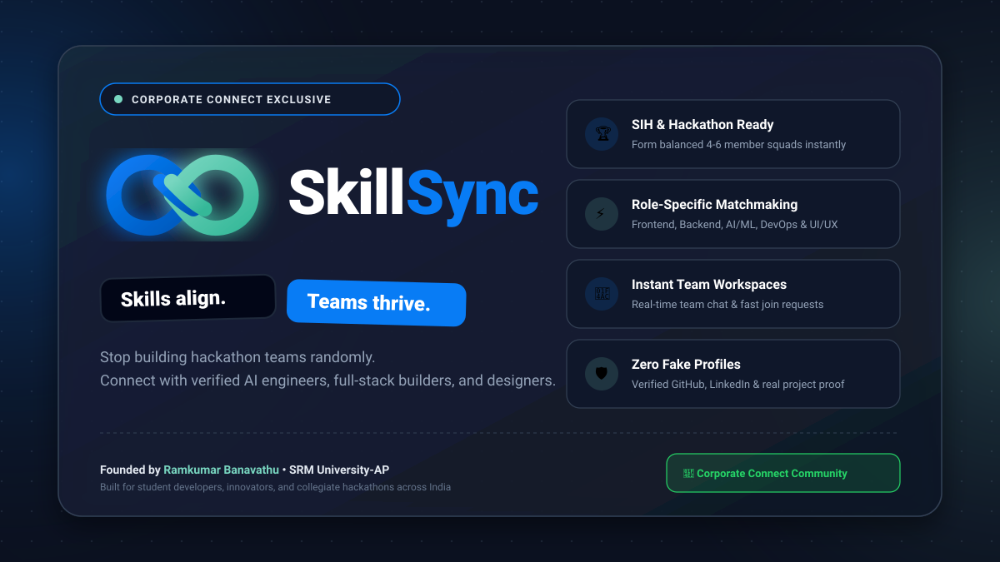
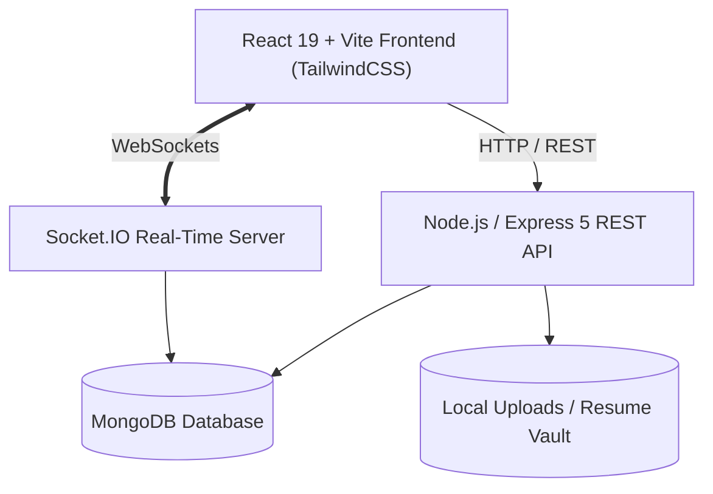

<div align="center">

  

  # ⚡ SkillSync
  ### *Skills align. Teams thrive.*

  **The Intelligent Matchmaking & Real-Time Collaboration Platform for Hackathons, SIH, and Collegiate Startups.**

  [](https://nodejs.org/)
  [](https://expressjs.com/)
  [](https://react.dev/)
  [](https://www.mongodb.com/)
  [](https://socket.io/)
  [](https://tailwindcss.com/)
  [](LICENSE)

</div>

---

## 📖 Table of Contents

- [🌟 What is SkillSync?](#-what-is-skillsync)
- [💡 Why SkillSync was Built](#-why-skillsync-was-built)
- [🎯 How SkillSync Helps Users](#-how-skillsync-helps-users)
- [✨ Key Features](#-key-features)
- [🏗️ System Architecture & Tech Stack](#️-system-architecture--tech-stack)
- [📁 Project Directory Structure](#-project-directory-structure)
- [🚀 Quickstart & Installation](#-quickstart--installation)
- [🔐 Environment Configuration](#-environment-configuration)
- [🧪 Running Automated Tests](#-running-automated-tests)
- [👨‍💻 Founder & Community](#-founder--community)

---

## 🌟 What is SkillSync?

**SkillSync** is a full-stack, production-ready web platform engineered to eliminate random hackathon teaming and developer fragmentation. 

Whether competing in the **Smart India Hackathon (SIH)**, building an AI challenge prototype, or kicking off a campus startup, SkillSync enables builders to discover complementary peers based on verified technical stacks, mutual competition goals, and real project proofs — backed by real-time team communication.

---

## 💡 Why SkillSync was Built

> *"Great ideas fail at hackathons not because students can't code, but because forming a balanced team is broken."*

While interacting with student developers, collegiate clubs, and tech communities across **SRM University-AP and multiple universities and developer organizations**, founder **Ramkumar Banavathu** noticed a recurring challenge:

1. **The Teaming Chaos:** Hundreds of students join hackathon WhatsApp/Discord groups asking *"Anyone need a frontend dev?"*, only to end up in unbalanced teams with 4 frontend coders and no backend or AI engineer.
2. **Ghosting & Inactivity:** Teammates chosen at random often drop out midway through 36-hour sprint challenges due to misaligned expectations.
3. **Unverified Claims:** No easy way to verify if a prospective teammate actually possesses the stated skills (AI/ML, DevOps, UI/UX, Cloud) or has genuine project repositories.
4. **Fragmented Workspaces:** Teams juggle between multiple external messaging apps and spreadsheets just to coordinate basic tasks.

**SkillSync was built to bridge this exact gap:** transforming chaotic teaming into a structured, merit-based, and friction-free process.

---

## 🎯 How SkillSync Helps Users

### 👨‍💻 For Solo Developers & Designers
* **Complementary Teaming:** Find teams that specifically need your exact skillset (e.g. an AI team looking for a React developer or UI/UX designer).
* **Portfolio Showcase:** Display verified GitHub repositories, LinkedIn profiles, and live project demos.
* **Resume Upload:** Upload PDF resumes securely for team leads to evaluate in one click.

### 👥 For Team Leads & Project Creators
* **Role-Based Recruitment:** Define precisely what roles your squad needs (Frontend, Backend, AI/ML, Mobile, UI/UX).
* **Join Request Management:** Review applicant profiles, skills, and resumes with one-click Accept/Reject controls.
* **Instant Team Workspaces:** Built-in real-time team chat powered by WebSockets — no external chat app needed.

### 🏆 For Hackathon Participants & Campus Innovators
* **SIH & Hackathon Ready:** Built-in support for Online, Offline / On-Campus, and Hybrid event formats.
* **Zero Fake Metrics:** Real database records with zero artificial filler data.

---

## ✨ Key Features

- **🎯 Role-Complementary Matching:** Filter and explore teams or members by domain, skills, and hackathon format.
- **💬 Real-Time Squad Chat:** Instant messaging powered by Socket.IO with optimistic zero-latency UI updates.
- **🛡️ Multi-Method Authentication:** Secure JWT authentication with HTTP-only cookies and Google OAuth Identity integration.
- **📄 Resume & Media Vault:** Secure file uploads for PDF resumes and developer avatars handled via Multer with MIME validation.
- **📊 Real Activity Analytics:** Live velocity charts tracking user signups and team formation activity without mock data.
- **📱 Responsive Neo-Brutalist UI:** High-polish design with slate and cobalt aesthetics, smooth transitions, and mobile-responsive drawer navigation.

---

## 🏗️ System Architecture & Tech Stack



### Technology Breakdown

| Layer | Technologies |
| :--- | :--- |
| **Frontend** | React 19, Vite, TailwindCSS, Zustand (State Management), React Router 7, Lucide Icons, Recharts |
| **Backend** | Node.js, Express 5, Socket.IO, Multer, Helmet, Express Rate Limit |
| **Database** | MongoDB with Mongoose ODM |
| **Authentication**| JSON Web Tokens (JWT), bcryptjs, Google Identity Services |
| **Testing** | Node.js native test runner (`node:test`), Supertest |

---

## 📁 Project Directory Structure

```text
SkillSync/
├── public/                       # Static public assets, SVG vectors & brand kit
│   ├── favicon.svg               # Vector brand infinity logo
│   ├── skillsync-promo.svg       # Landscape brand announcement banner
│   ├── skillsync-square.svg      # Square social post graphic
│   └── export-banner.html        # 1-click PNG high-res graphic exporter
├── server/                       # Backend Express API & Socket.IO services
│   ├── controllers/              # Route controllers (auth, team, message, user, etc.)
│   ├── middleware/               # Auth guards, upload validation, rate limiting
│   ├── models/                   # Mongoose schemas (User, Team, Message, Request)
│   ├── routes/                   # Express REST endpoints
│   ├── scripts/                  # Database management & seed utilities
│   ├── socket/                   # Real-time WebSocket handlers & channel rooms
│   ├── tests/                    # Automated API integration test suite
│   └── server.js                 # Express server & Socket.IO server initialization
├── src/                          # Frontend React 19 Application
│   ├── components/               # Modular UI components, modals, and team drawers
│   ├── context/                  # React Context providers (AuthContext, etc.)
│   ├── hooks/                    # Custom React hooks
│   ├── pages/                    # Application pages (Landing, Dashboard, Teams, Chat)
│   ├── services/                 # Axios API service clients
│   ├── store/                    # Zustand global stores (Messages, UI)
│   └── main.jsx                  # React application entry point
├── uploads/                      # Secure file storage for avatars and PDF resumes
├── .env.example                  # Environment configuration template
├── package.json                  # Dependencies & scripts
└── tailwind.config.js            # Tailwind theme configuration
```

---

## 🚀 Quickstart & Installation

### Prerequisites
- [Node.js (v18 or higher)](https://nodejs.org/)
- [MongoDB (Community Server or MongoDB Atlas)](https://www.mongodb.com/)
- `npm` or `pnpm`

### 1. Clone the Repository
```bash
git clone https://github.com/banavathuramkumar/SkillSync.git
cd SkillSync
```

### 2. Install Dependencies
```bash
npm install
```

### 3. Setup Environment Variables
Create a `.env` file in the root directory (or copy from `.env.example`):
```bash
cp .env.example .env
```
*(Configure `MONGODB_URI` and `JWT_SECRET` inside your `.env` file).*

### 4. Start the Application
Run both the backend server and frontend development server:

```bash
# Terminal 1: Start Backend API (Port 5000)
npm run server

# Terminal 2: Start Frontend Development Server (Port 5173)
npm run dev
```

Visit **`http://localhost:5173`** in your browser.

---

## 🔐 Environment Configuration

| Variable | Description | Default |
| :--- | :--- | :--- |
| `PORT` | Port for the Express backend server | `5000` |
| `NODE_ENV` | Application environment mode | `development` |
| `MONGODB_URI` | MongoDB connection connection string | `mongodb://127.0.0.1:27017/skillsync` |
| `JWT_SECRET` | Secret key for signing authentication tokens | *(Set a secure string)* |
| `JWT_EXPIRES_IN`| Token lifespan | `7d` |
| `CLIENT_URL` | Allowed frontend origin for CORS & WebSockets | `http://localhost:5173` |
| `UPLOAD_DIR` | Directory for uploaded resumes & images | `./uploads` |

---

## 🧪 Running Automated Tests

Run the backend integration test suite:

```bash
npm test
```

All API endpoints, authentication flows, and permission guards are tested.

---

## 👨‍💻 Founder & Community

* **Created & Engineered by:** **[Ramkumar Banavathu](https://github.com/banavathuramkumar)** (SRM University-AP)
* **Official Community:** **Corporate Connect** — *"Never Miss an Opportunity"*  
  💬 [Join the Corporate Connect WhatsApp Channel](https://whatsapp.com/channel/0029VbDvlzXBKfi7j5EOYO2r)

---

## 📄 License

This project is licensed under the [MIT License](LICENSE).
